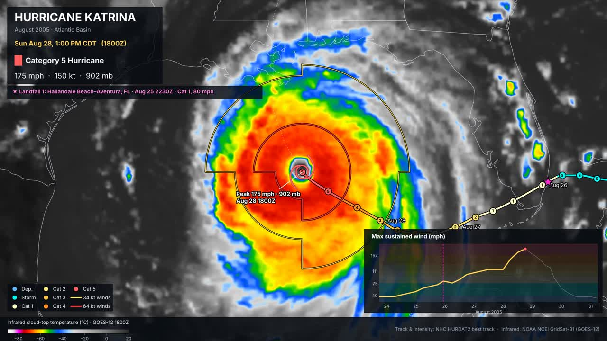

# Weather Map Studio

Detailed weather maps and animations for social media, made from free NOAA data, with Claude built
in so you can ask for new maps in plain English.

## What it makes today

| Map | What you get |
|---|---|
| **Hurricane animation** | Camera follows any storm on infrared satellite from birth to death: track colored by category, intensity markers, wind field, landfalls, wind chart. Works for any Atlantic or East Pacific storm from 1983 on, including storms happening right now. |
| **Upper-air analysis** | 500 mb heights and anomalies, 250 mb jet stream, 850 mb temperature anomalies (3 images). |
| **Severe outbreak recap** | Radar time lapse of any past outbreak with warnings appearing and expiring, plus tornado, hail and wind reports. |
| **Hazard map** | National map of a big hazard (extreme cold, heat, blizzard, ice, wind, fire weather, flooding) with live observations and fronts. |

More samples are in the [gallery](gallery/).

## The 3 ways to use it

### 1. Make a map with a button (no code)
1. Click the **Actions** tab, then **Make a map** on the left.
2. Click **Run workflow ▾**, pick the map and fill in the boxes (for example storm `IAN`, year `2022`).
3. Click the green **Run workflow** button. Wait for the green ✅ (hurricane animations take about 15–25 minutes).
4. Open the run, scroll to **Artifacts** at the bottom, and download your map.

### 2. Ask Claude to build something new
1. Click the **Issues** tab, then **New issue**, then **Ask Claude to build or change something**.
2. Describe what you want in plain English, for example:
   - "Make a map of today's snowfall across the Midwest."
   - "Make the hurricane animation vertical (9:16) for TikTok."
   - "Make an animation of Hurricane Helene 2024 and attach it."
3. Submit. Claude reads the repo, builds it, tests it, attaches any maps it made to the run, and
   opens a **pull request** (a proposed change). It comments on your issue when it's done.
4. Look at the pull request. If you like it, click **Merge pull request**. That's how changes get saved.

You can keep talking to Claude by commenting on the issue or pull request with `@claude ...`.

### 3. Turn on autopilot (optional, later)
The **Autopilot** workflow watches the weather and builds maps automatically when something big
happens. It's off until you add the variable `AUTOPILOT` = `on` (see setup below). It only posts to
X if you also add `POST_TO_X` = `on`.

## One-time setup

### Connect Claude (required for way 2)
Claude runs on your Claude Pro/Max plan using a token:
1. Install Claude Code on your computer. On Windows, open **PowerShell** and run:
   `irm https://claude.ai/install.ps1 | iex`
   (Mac/Linux: `curl -fsSL https://claude.ai/install.sh | bash`)
2. Close that window, open a **new** PowerShell window, and run `claude setup-token`. A browser opens: log in and approve.
   It prints a long token starting with `sk-ant-oat`. Copy it.
3. In this repo: **Settings → Secrets and variables → Actions → New repository secret**.
   Name: `CLAUDE_CODE_OAUTH_TOKEN`, Secret: paste the token. Click **Add secret**.

### Optional secrets and variables
Same page (**Settings → Secrets and variables → Actions**):

| Type | Name | What for |
|---|---|---|
| Secret | `ANTHROPIC_API_KEY` | Claude-written post text (otherwise a template is used) |
| Secret | `X_API_KEY`, `X_API_SECRET`, `X_ACCESS_TOKEN`, `X_ACCESS_TOKEN_SECRET` | Only if you want posting to X |
| Variable | `BOT_BRAND` | Your name or brand, stamped on every map |
| Variable | `BOT_HANDLE` | Your handle, e.g. `@yourname`, shown on the maps |
| Variable | `NWS_CONTACT` | Your email (the weather service asks apps to identify themselves) |
| Variable | `AUTOPILOT` | `on` to enable automatic event maps |
| Variable | `POST_TO_X` | `on` to let autopilot post to X |

## Where things live (if you're curious)
- `studio/products/`: one file per map type
- `studio/config.py`: settings
- `.github/workflows/`: the buttons and automations
- `CLAUDE.md`: instructions Claude follows when working in this repo
- `gallery/`: sample images

Data: NOAA/NWS, National Hurricane Center, GOES satellites (NOAA/NESDIS), NCEI GridSat, NCEP GFS,
Iowa Environmental Mesonet. All free and public.
